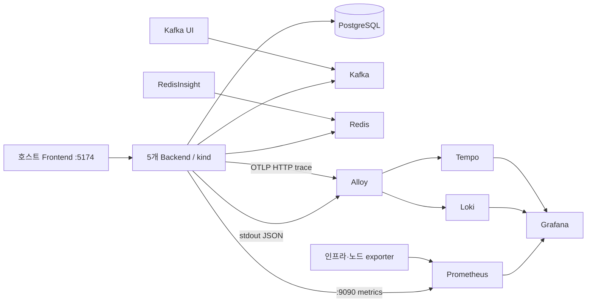
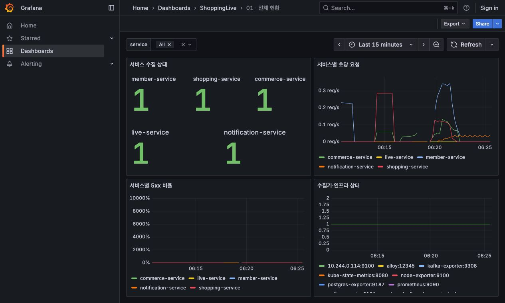
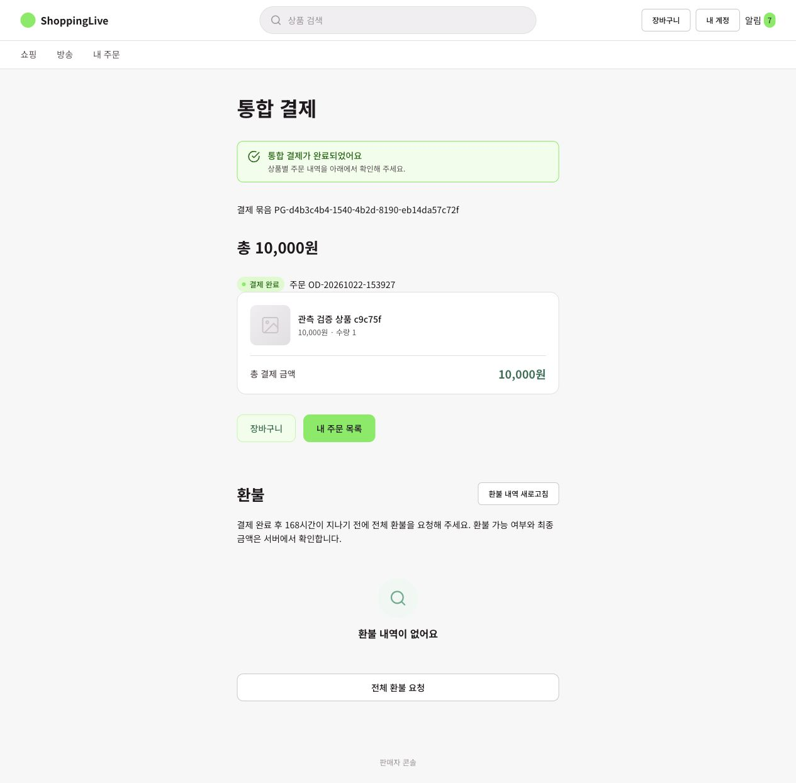
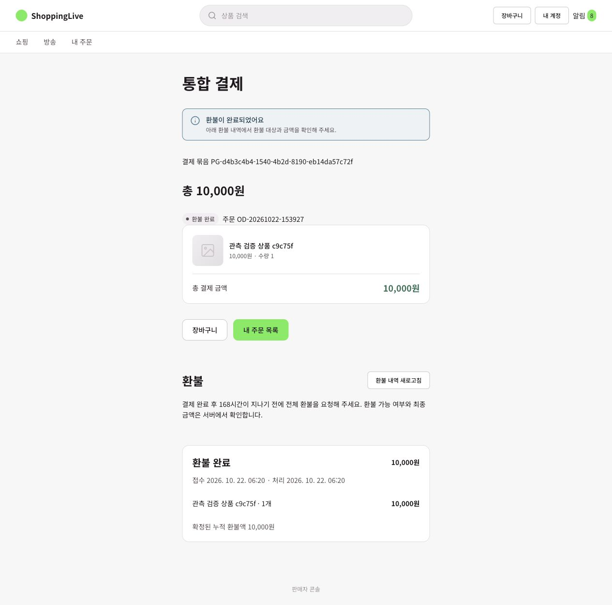
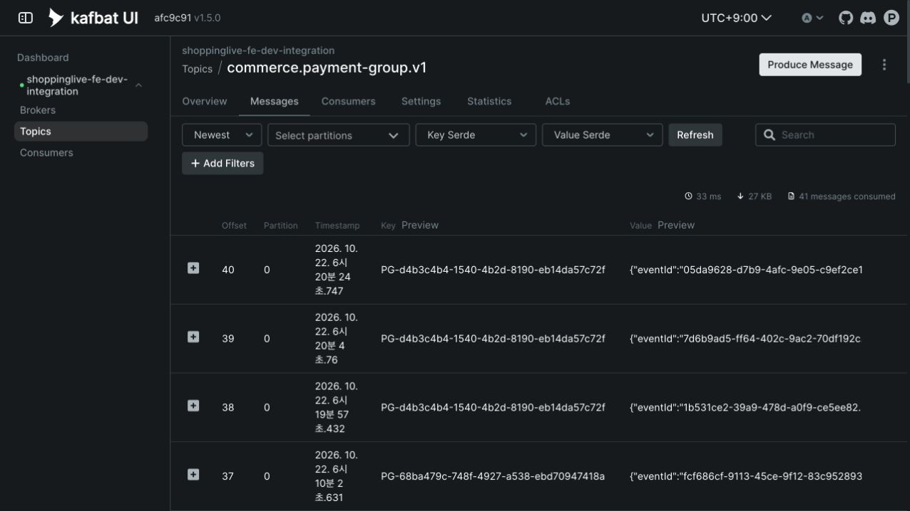
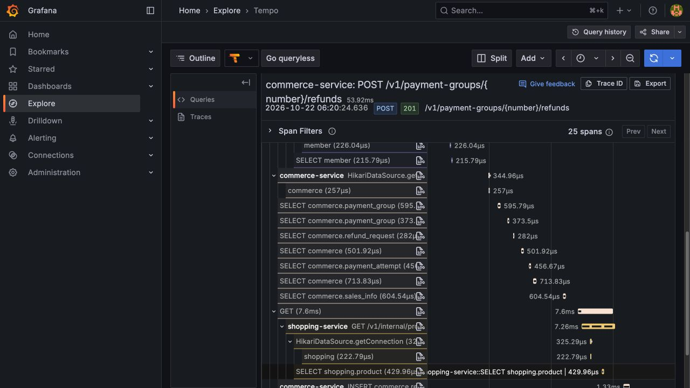

# 로컬 kind 관측 1단계 — 구현·실행·다음 실험

목표는 **프론트에서 구매 버튼을 누른 뒤 API → DB/Outbox → Kafka → 소비 서비스까지 실제로 확인하고, 이후 부하테스트의 기준점을 만드는 것**이다. 구현 시점은 2026-10-22이며 수치는 단일 개발 환경의 기능 검증 결과다.

## 결과물과 적용 순서

| 작업 | 결과물 | 핵심 범위 |
|---|---|---|
| Infra 1 | [#13](https://github.com/2026-2-rising-sun/Infra/pull/13), 이슈 #11 | 기존 kind 조사·보호 백업, 정확한 서비스 네임스페이스에 Kafka UI·RedisInsight 연결 |
| Backend 1 | [#305](https://github.com/2026-2-rising-sun/Backend/pull/305), 이슈 #303 | 5개 서비스 공통 HTTP/JVM/DB 풀 메트릭, JSON 완료 로그, 별도 관리 포트 |
| Infra 2 | 이슈 [#12](https://github.com/2026-2-rising-sun/Infra/issues/12) | Prometheus·Loki·Tempo·Alloy·Grafana, exporter, OTel agent 배포, 이 문서 |
| Backend 2 | [#306](https://github.com/2026-2-rising-sun/Backend/pull/306), 이슈 #304 | 주문·결제·환불·Outbox·소비 결과 및 미해결 업무 계측 |

Infra 1 → Backend 1과 Infra 2 → Backend 2 순서로 연결한다. Backend 2 PR은 Backend 1 브랜치를, Infra 2 PR은 Infra 1 브랜치를 기준으로 한다. 하위 PR 병합 후 상위 PR의 기준 브랜치를 각각 dev/main으로 바꾼다. 이번 작업에서는 병합하지 않는다.

프론트는 기존 Vite를 호스트에서 실행한다. 프론트 배포 코드는 옮기지 않는다. 실제 배포, k6/nGrinder, 용량 산정, 신규 캐시·대기열, 분산 비동기 추적은 다음 단계다.

## 세 작업은 이렇게 연결된다

- **Infra 1 — 기존 환경을 지키고 연결 대상을 확정한다.** `k8s/local/observe.py`가 기존 리소스와 볼륨을 조사하고 PostgreSQL·Kubernetes 설정을 보호 디렉터리에 백업한다. Kafka UI·RedisInsight는 별도 관측 네임스페이스에서 기존 Kafka·Redis에 연결한다.
- **Backend 1 — 모든 서비스가 같은 방식으로 데이터를 낸다.** `local,observability` 프로필에서 관리 포트 9090, HTTP 지연 histogram, JVM·Hikari 메트릭과 구조화 로그를 켠다. API 진입 포트의 Prometheus 접근은 거부한다. HTTP/JDBC 기본 span은 Infra가 이미지에 넣는 OTel agent가 생성한다.
- **Infra 2 — 수집·저장·조회 환경을 코드로 재현한다.** Prometheus가 메트릭을, Alloy가 Pod stdout 로그와 OTLP trace를 수집한다. Loki·Tempo에 저장하고 Grafana 5개 대시보드와 trace 조회로 확인한다. 설정 변경은 파일 → 재적용으로 반영한다.



## Backend 2는 확정된 업무와 시도를 구분한다

성공 HTTP 응답, Outbox 저장, 브로커 ack, 소비 서비스 반영은 서로 다른 시점이다. 주문 식별자·eventId는 로그에서 연결하고, 메트릭에는 서비스·결과·고정된 이벤트 종류처럼 값의 종류가 제한되는 라벨만 붙인다.

| 업무 / 코드 경계 | 추가 지표 — Prometheus 이름 | 기록 기준 | 로그·확인 예시 |
|---|---|---|---|
| 주문·결제 묶음 생성 / `OrderCreationService`, `PaymentGroupService` | `shoppinglive_order_requests_total{unit,result,reason}` Counter | `unit=order/group`, `created/replayed`는 트랜잭션 커밋 후. 예외는 `rejected`와 ErrorCode로 구분 | 동일 멱등 키 두 번 → created 1, replayed 1. orderNumber/groupNumber는 로그만 |
| 결제 접수 / `PaymentGroupLifecycleService` | `shoppinglive_payment_operations_total{operation="payment_intake",result="accepted"}` Counter | 새 결제 시도 저장이 커밋된 때. 같은 시도 재조회는 접수 증가 없음 | 접수는 결제 완료와 다름. 최종 결과는 PaymentSucceeded/PaymentFailed 이벤트 확인 |
| 결제·환불 실행 / `PaymentRecoveryStore`, `RefundRecoveryStore`, `RefundOutcomeService` | `shoppinglive_payment_operations_total{operation,result}` Counter | `*_beginInvocation`: first_attempt/retry/skipped. `*_unknown`: unknown/skipped. payment_complete·refund_apply: SUCCESS/FAILED/skipped. 실행 오류는 error | paymentAttemptId/refundRequestId로 시도 로그 연결. 독립 트랜잭션에서 확정된 beginInvocation/unknown은 즉시 집계 |
| 환불 접수 / `RefundIntakeService` | 같은 Counter, `operation="refund_intake"`, `result=accepted/replayed` | 커밋 후 새 요청·재요청 구분 | 접수 후 처리 중 화면과 최종 RefundCompleted를 각각 확인 |
| 취소·만료 / `PaymentGroupService` | `shoppinglive_lifecycle_failures_total{operation}` Counter + 아래 도메인 이벤트 | 실패 시도는 cancel/expire. 확정 성공은 OrderCancelled/OrderExpired 이벤트 | API 호출 수를 실제 취소 건수로 해석하지 않음 |
| 도메인 이벤트 / `EventOutbox.append` | `shoppinglive_domain_events_total{event_type,topic}` Counter | Outbox append를 포함한 트랜잭션 커밋 후에만 증가 | PaymentGroupCreated, PaymentSucceeded, PaymentFailed, RefundCompleted, OrderCancelled, OrderExpired, InventoryChanged 등. eventId/aggregateId 로그 |
| Kafka 발행 / `OutboxRelay` | `shoppinglive_outbox_send_seconds_count`, `_sum`, `_max` Timer, `result=broker_acked/failed` | Kafka send future 결과가 확인된 때. 단위 초 | 브로커 ack와 DB published_at 갱신은 다름. ack 횟수에 중복 발행이 포함될 수 있음 |
| Shopping 반영 / sales·coupon listener/repository | `shoppinglive_consumer_seconds_count`, `_sum`, `_max`, `result=applied/duplicate_or_stale` | listener의 eventId 문맥에서 실제 repository 결과·커밋 후 | eventId, salesId/couponId, snapshotVersion. REST 보정 조회는 소비 지표에서 제외 |
| Notification 반영 / listener·`createAll` | 같은 Timer, `result=applied/duplicate_or_no_recipient` | 대상 이벤트의 실제 알림 생성 결과·커밋 후 | eventId/eventType/businessId. 0건은 중복 또는 수신 대상 없음이며 중복만으로 단정하지 않음 |
| 소비 실패 / Shopping·Notification listener | `shoppinglive_consumer_failures_total{result="failed"}` Counter | listener 실패 전달마다 한 번. 재시도는 별도 실패 시도로 남음 | eventId/topic/partition/offset. 원래 예외와 Kafka 재시도 정책 유지 |
| 미해결 업무 / `PendingWorkMetrics` | `shoppinglive_pending_count{kind}`, `shoppinglive_pending_oldest_seconds{kind}` Gauge | 별도 스레드가 30초마다 DB 조회. 쿼리 제한 2초, 시작 5초 후 첫 조회 | payment=PENDING/PROCESSING/UNKNOWN, refund=PROCESSING/UNKNOWN, outbox=published_at NULL, refund_retry_exhausted=해당 환불 중 retry_count≥3 |
| 집계 신선도 | `shoppinglive_pending_sample_timestamp_seconds` Gauge, `shoppinglive_pending_query_failures_total` Counter | 전체 집계 성공 시 시각 갱신. 실패 시 값 NaN·실패 증가 | 수집 실패를 미해결 0건으로 표시하지 않음. 동일 DB를 읽는 복제본 값은 max로 조회 |

`BusinessTelemetry`는 트랜잭션 커밋 콜백과 MDC 복원을 공통 처리한다. 로그 출력·메트릭 오류가 업무 결과를 바꾸지 않게 한다. 기존 비즈니스 정책, API·이벤트 payload, DB 스키마는 변경하지 않는다. 미해결 집계 SQL은 현행 PostgreSQL에서 실행 확인했으며 DB 규모 증가 시 조회 비용을 다시 측정한다.

### 로그는 Pod stdout에 남기고 Loki에서 찾는다

- 공통 완료 로그: `event=http_completed`, requestId, method, **경로 템플릿** route, status, durationMs. SSE는 연결 시작이 아닌 실제 종료 시 한 번 기록한다.
- 업무 로그: 위 표의 metric 이름을 event로 사용하며 업무 결과·식별자를 남긴다. agent가 있는 HTTP 문맥에는 `trace_id`, `span_id`가 추가된다.
- 본문, Authorization, 쿠키, 멱등 키 원문, 결제 수단은 새 로그에 넣지 않는다. 기존 업무 로그 전체를 재작성하는 범위는 아니다.
- Loki 색인은 service/namespace/pod/container다. 주문번호·eventId·traceId는 JSON에서 검색하며 색인 라벨로 승격하지 않는다.

```logql
{service="commerce-service"} | json | event="http_completed" | route="/v1/payment-groups/{number}/refunds"
{service=~"commerce-service|shopping-service|notification-service"} |= "05da9628-d7b9-4afc-9e05-c9ef2ce18a79"
```

요청 완료 로그의 requestId, 소비 로그의 eventId가 MDC와 중복되어 JSON 출력이 거부되는 문제를 실제 실행 중 발견했다. 중복 필드를 제거하고 실제 JSON 콘솔 출력까지 확인하는 회귀 테스트를 추가했다.

### 특정 API 지연도 확인한다

```promql
# API별 95백분위 응답 시간(초): 인스턴스 histogram을 먼저 합산한다.
histogram_quantile(0.95,
  sum by (le, service, uri) (
    rate(http_server_requests_seconds_bucket{service="commerce-service",uri!~"/actuator.*"}[5m])
  )
)

# 같은 DB를 조회하는 여러 Pod의 미해결 건수를 더하지 않는다.
max by (kind) (shoppinglive_pending_count{service="commerce-service"})

# 집계가 오래되었는지 확인한다. 임계값은 이후 운영 주기에 맞춰 결정한다.
time() - max(shoppinglive_pending_sample_timestamp_seconds)
```

지표의 `uri`는 `/orders/{orderNumber}` 같은 경로 템플릿이다. 주문마다 라벨을 만들지 않는다. HTTP 지연은 해당 요청이 끝날 때까지의 시간이며, 응답 후 비동기 결제·환불 완료 시간과 다르다. 기본 trace는 원인 탐색용이고, 별도 상용 APM을 추가하지 않는다.

## 화면은 서비스·인프라·노드로 나눈다

| 대시보드 | 가져오는 데이터 | 해석 |
|---|---|---|
| 01 전체 현황 | 5개 앱 up, 요청률, 5xx 비율, 수집기 상태 | 서비스가 실행 중인지와 실제로 메트릭이 수집되는지를 구분 |
| 02 서비스·API | API p95, 요청·오류, JVM heap/GC/thread, Hikari active/pending | 느린 API와 풀·GC 대기를 함께 확인 |
| 03 인프라 | PostgreSQL 연결·commit/rollback·lock wait·deadlock, Kafka lag, Redis 메모리·명령·eviction·연결·키 | exporter 상태와 실제 자원 지표를 함께 확인. 캐시 hit 비율은 앱의 캐시 적용 사실과 별도로 해석 |
| 04 노드·Pod | 노드 CPU·메모리, Pod CPU·메모리·재시작·OOM·Ready·복제본 | node-exporter는 노드마다 DaemonSet, kubelet/cAdvisor·kube-state-metrics 수집 |
| 05 구매 업무 | 확정 이벤트·주문·결제/환불·미해결·Outbox·소비·JSON 업무 로그 | 브라우저 동작과 비동기 반영이 어디까지 갔는지 추적 |

Prometheus·Grafana는 로컬에서 한 세트를 공유하며 service/pod/node 라벨로 구분한다. 이번 kind는 control-plane 1개다. 노드 지표는 kind/Docker 가상 환경 기준이고 물리 서버 3개의 성능·장애 격리를 증명하지 않는다.

## 실행 순서

전제: Docker·kind·kubectl·Python 3·Java 21, 기존 `kind-shoppinglive-dev`, 실행 중인 5개 서비스와 PostgreSQL/Kafka/Redis. 새 클러스터를 만드는 스크립트가 아니다. 기본 앱 네임스페이스는 `shoppinglive-fe-dev-integration`이고 관측용은 `shoppinglive-observability`다.

```sh
# Infra 레포에서 실행. inspect는 비밀번호를 출력하지 않는다.
python3 k8s/local/observe.py inspect
python3 k8s/local/observe.py backup --output "$HOME/.shoppinglive-backup/phase1-YYYYMMDD"
python3 k8s/local/observe.py tools --apply
python3 observability/local/deploy.py --apply

# Backend 경로는 계측 PR을 포함하고 변경이 커밋된 작업 공간으로 지정한다.
# 자동으로 bootJar 빌드 → agent 체크섬 검증 → 이미지 빌드/load → 앱별 순차 rollout.
JAVA_HOME=/path/to/jdk21 python3 observability/local/instrument.py \
  --backend /absolute/path/to/Backend \
  --backup "$HOME/.shoppinglive-backup/apps-YYYYMMDD" --apply
```

- `deploy.py`, `observe.py tools`, `instrument.py`는 `--apply` 없이 실행하면 manifest/계획만 출력한다. `instrument.py`에는 backend/backup 인자가 필요하다.
- 백업은 새 경로여야 한다. 설정 백업과 SQL에는 비밀정보가 포함되므로 Git 밖에 두며 공유하지 않는다. 디렉터리 0700·파일 0600으로 저장한다. `observe.py`는 Kafka·Redis 데이터를 백업하지 않는다.
- 기존 PostgreSQL·Kafka가 emptyDir인 사실을 확인했으므로 Pod를 교체하지 않았다. 오래된 다른 네임스페이스도 임의 삭제하지 않았다. 앱의 `/tmp/images`는 교체 전에 tar로 보관하고 교체 뒤 복구한다.
- PostgreSQL exporter 전용 `sl_observer` 계정에 pg_monitor를 주며 접속 문자열은 Secret에 저장한다. Grafana 관리자 비밀번호도 Secret으로 만든다.
- OTel Java agent 2.20.0을 공식 GitHub 배포에서 내려받아 고정 SHA256을 검증한다. HTTP·JDBC·log MDC만 선택적으로 켠다. agent 자체 OTLP 로그·메트릭 export는 꺼서 중복 수집하지 않는다.
- `kubectl`로 변경한 임시 설정은 명시적으로 원복한다. 앱 원복은 보호 백업의 Deployment spec을 검토해 적용하며, DB migration은 이미지 원복만으로 되돌아가지 않는다.

서로 다른 터미널에서 필요한 화면만 연다. 모두 localhost에만 노출한다.

```sh
kubectl --context kind-shoppinglive-dev -n shoppinglive-observability port-forward svc/grafana 13000:3000
kubectl --context kind-shoppinglive-dev -n shoppinglive-observability port-forward svc/prometheus 19090:9090
kubectl --context kind-shoppinglive-dev -n shoppinglive-observability port-forward svc/kafka-ui 18080:8080
kubectl --context kind-shoppinglive-dev -n shoppinglive-observability port-forward svc/redisinsight 15540:5540

# Frontend 레포에서 기존 실행 경로 사용
KIND_NAMESPACE=shoppinglive-fe-dev-integration node scripts/local-frontend.mjs
```

Frontend는 [5174](http://127.0.0.1:5174), Grafana는 [13000](http://127.0.0.1:13000), Kafka UI는 [18080](http://127.0.0.1:18080), RedisInsight는 [15540](http://127.0.0.1:15540)이다. Pod가 교체되면 기존 port-forward가 끊길 수 있으므로 해당 터미널을 다시 실행한다. Grafana 일반 대시보드는 로컬 익명 Viewer이며 관리자 기능은 Secret의 계정으로 로그인한다. RedisInsight 첫 실행 약관은 사용자가 확인한다.

## 보존·추적 범위와 배포 환경 차이

- Prometheus·Loki·Tempo 데이터 보존은 24시간, PVC는 각각 2Gi다. Prometheus는 추가로 1GB 보존 크기를 설정했다. Alloy 수집 위치와 Grafana 설정도 각각 2Gi PVC를 사용한다. kind 삭제나 Docker 저장소 초기화까지 보존하지는 않는다.
- 요청 trace는 로컬에서 100% sampling. Alloy에서 SQL 원문과 URL query/full/target 필드를 제거한다. HTTP 요청과 해당 DB·동기 내부 HTTP 호출이 연결된다. Kafka 비동기 구간은 eventId로 로그를 연결하며 하나의 trace로 연결했다고 주장하지 않는다.
- 서비스 코드의 지표·로그 형식은 배포 환경에서도 재사용한다. 환경별 endpoint, sampling, 보존 기간, 리소스, 인증/TLS, 접근 통제, 저장소·HA, 경보 기준은 배포 설정으로 달리한다. 이 로컬 익명 UI 설정을 외부에 그대로 공개하지 않는다.
- 알림 라우팅·운영 SLO·장기 보존·대규모 인덱스 최적화는 이번 1단계에 포함하지 않는다.

## 실제 확인한 결과와 화면

아래 이미지는 2026-10-22 로컬에서 직접 캡처했다. 목업 이미지나 예시 성능 수치가 아니다. 테스트 외에도 기존 개발 데이터가 있으므로 토픽 누적 메시지 수를 이번 테스트의 발행 건수로 해석하지 않는다.

**전체 수집 상태:** 5개 서비스의 `up=1`을 Prometheus API와 Grafana에서 확인했다.



**브라우저 구매·환불:** 상품 265, 주문 `OD-20261022-153927`, 결제 묶음 `PG-d4b3c4b4-1540-4b2d-8190-eb14da57c72f`에서 10,000원 Mock 결제 후 전체 환불을 완료했다. 환불 25는 API에서도 SUCCESS, 결제 묶음과 주문은 REFUNDED였다.





**이벤트·trace 교차 확인:** PaymentSucceeded의 eventId는 `7d6b9ad5-ff64-402c-9ac2-70df192cab8a`, RefundCompleted는 `05da9628-d7b9-4afc-9e05-c9ef2ce18a79`였다. refund 접수 trace `0eae6f26c6a99ed4cbdcdd14d1bf8f94`를 Tempo에서 조회해 HTTP·JDBC span 25개와 Member/Shopping 동기 호출을 확인했다. SQL 원문·URL query 속성은 저장된 trace에서 없음을 확인했다. 브로커 ack의 짧은 시간값을 전체 업무 지연이나 처리 성능으로 해석하지 않는다.





최종 Backend 이미지 `bae16ddadb80`에서도 주문 재요청(201→200, 같은 주문번호), 취소(204), 정상 요청 JSON 로그와 Notification 소비 로그를 확인했다. 복구 검증 주문 `OD-20261022-342469`는 `SUCCESS_RESPONSE_LOST` Mock 설정에서 PAYMENT_CONFIRMING이 되었고 `pending{kind="payment"}≥1`이 수집됐다. 관측을 위해 잠시 끈 recovery를 복구하자 PAID가 됐다. 임시 JVM 설정은 모두 원복했다. 이 과정의 Pod 교체 이후에도 Prometheus는 새 Pod를 자동 발견했다.

**Redis는 실제 사용 경로로 검증한다.** 현재 소스의 직접 Redis 호출은 Live 시청자 presence와 Pub/Sub에 있다. 모든 서비스가 상품 캐시를 사용하는 것은 아니다. 방송 87을 프론트에서 열었을 때 화면의 시청자 1명과 Redis `live:viewers:87`의 ZSET 1개·TTL을 교차 확인했다. 영상은 IVS stub이며 실제 송출 검증은 아니다. RedisInsight는 배포·접속 화면까지 확인했고, 최초 약관 동의는 사용자 확인 대상으로 남겨 두었다.

## 팀원은 시나리오별로 다음 실험을 이어간다

1단계 완료 기준은 **동작 → 데이터 → 화면이 연결되고 재현 가능한가**다. 이후에는 `시나리오·불변식 정의 → 스크립트 → 기준 측정 → 병목 가설 → 개선 → 같은 조건 재측정`을 반복한다.

| 이후 시나리오 | 부하 스크립트에서 확인할 내용 | 이번 지표의 역할 |
|---|---|---|
| 조회 유입 증가 | 고정 데이터·캐시 상태로 상품 목록/상세 요청률 단계 증가 | API p95, DB 풀 대기, CPU/GC. 현재 존재하지 않는 캐시 효과는 주장하지 않음 |
| 한정 재고 동시 구매 | 여러 사용자·서로 다른 멱등 키로 동시 요청, 성공 주문 합계≤초기 재고, 최종 재고≥0 DB 검증 | created/rejected/재고 부족, API 지연, lock wait. 지표만으로 정합성 증명 불가 |
| 동일 요청 재전송 | 동일 키·동일 payload 동시 재시도, 주문·결제 중복 생성 금지 | created/replayed, DB 레코드·결제 시도 수 교차 확인 |
| PG 지연·응답 유실 | 로컬 Mock 시나리오와 복구 스케줄러로 UNKNOWN→최종 결과 검증 | unknown/retry·미해결 건수/최고 대기·PaymentSucceeded |
| 취소·환불 경합 | 결제/취소/환불 동시 요청, 최종 상태·재고·환불액 불변식 | 확정 이벤트와 실패 시도, PostgreSQL 정합성 조회 |
| Kafka 지연·중복 | 테스트 소비 지연/같은 eventId 재전달, 중복 반영 방지 | lag·미발행 Outbox·consumer 결과·eventId 로그 |
| SSE/Live 연결 증가 | 동시 연결·재연결·느린 클라이언트, Live Redis 데이터 경로 구분 | JVM thread/heap·Pod 메모리·Redis 메모리, 종료 시 HTTP 지표 |

HTTP 부하 발생은 k6 같은 스크립트 도구로, 실제 화면 회귀는 Playwright로 분리한다. 이번 작업은 부하테스트 결과를 제공하지 않는다. 로컬 결과에는 부하 발생기·앱·DB·관측기가 같은 자원을 쓴다는 제약을 남기고, 배포 전 테스트 서버에서 동일 스크립트를 별도 발생기로 다시 측정한다.
